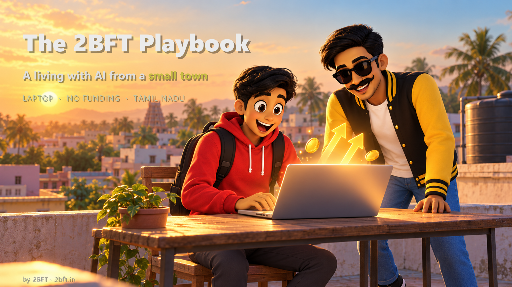

# The 2BFT Playbook

**How two founders make a living with AI from a small town — a laptop, a family jewellery shop, and no outside funding.**

We are **2 Boys From Town (2BFT)** — Navaratan and Sujal — building an AI studio above our family jewellery shop in **Vaniyambadi, a small town in Tamil Nadu, India**. No metro city, no office, no investors. This is the honest version of how we actually earn with a laptop and an internet connection, written down so the next small-town builder can see the whole picture instead of a highlight reel.

This is a playbook, not a promise. We are documenting what pays our bills — the work, the rough prices, and what we got wrong — not selling a shortcut. Your results are your own.

---

## The streams that pay us

### 1. Brand animations — about ₹500–600 per reel
Short animated videos and reels for brands and creators. The point is volume at a fair price: a brand gets a steady stream of motion content without a city studio's rates. We build them with a mix of code-drawn animation and AI tools, so one person can turn a brief around fast. Most of our open-source tools below came straight out of this work.

### 2. 2BFT Academy — paid workshops and hackathons
We teach what we actually use, through live workshops and hackathons people pay to join. **Over 250 builders** have come through so far. It is also how brands and students find the studio.

### 3. 2BFT.studio — websites and digital services
We design and build websites and digital products for clients, remotely from a small town. **₹30,000 from our first two delivered sites** — the start of our highest-value stream.

### 4. Stashed — our own AI-built product
We **thought up and designed a tech backpack with AI**, built it with **small-and-medium bag factories in Chennai**, and marketed it with AI from our small town. A unique concept, tested in the real market: **60 pieces sold in 6 months**. Proof that a small-town team can design, make and sell a physical product end to end.

---

## The numbers, honestly

- **₹6 lakh+** total earnings tracked in our **first year** of launching
- **250+ builders** through workshops and hackathons
- **2 client websites delivered** (₹30,000 so far)
- **60 Stashed bags sold** in 6 months
- Brand reels at **₹500–600 each**

No projections, no "this could be you." These are the real totals to date.

---

## The 2BFT family

- **[2bft.in](https://2bft.in)** — the Academy and our courses
- **2bft.studio** — client websites and digital products
- **2bft.gaming.tn** *(launched on our 1-year birthday)* — a gaming and esports initiative for tier-3 cities, towns and villages
- **2bft.cartoons** *(launched on our 1-year birthday)* — **Talking Radio, Season 1**: 5 episodes in English, Hindi and Tamil, written and produced by one author using a single Claude and **no extra cost**, with an offline + online model combination. 🎧 Watch: **https://2boysfromtown.github.io/thinking-radio/**

---

## The tools we use (free and open)

Open-sourced from our own paid work, so you can see exactly how the deliverables are made:

- [hyperframes-motion](https://github.com/2boysfromtown/hyperframes-motion) — After Effects-style motion graphics in plain HTML
- [indic-voice-clone](https://github.com/2boysfromtown/indic-voice-clone) — clone your own voice in Tamil, Hindi and English, offline
- [photo-to-tamil-ad](https://github.com/2boysfromtown/photo-to-tamil-ad) — one product photo → a finished Tamil video ad
- [thinking-radio](https://github.com/2boysfromtown/thinking-radio) — the Talking Radio cartoon series, built with Claude

More at [github.com/2boysfromtown](https://github.com/2boysfromtown).

---

## What we learned

- **One high-value stream funds the rest.** The websites and product pay the bills; the reels and workshops compound the audience.
- **Price for the town you're in, deliver for the city.** Low prices only work if the work is fast — which is why we automate everything we can.
- **Teaching is marketing.** Every workshop builder is someone who has seen the work up close.
- **Being from a small town is not a disadvantage online.** The client does not know, and does not care, where the laptop is.

---

## Learn the workflows

We teach the full build process — voice, video, websites, automation — in our course at **[2bft.in](https://2bft.in)**.

---

Built by **2BFT, Two Boys From Town** — Vaniyambadi, Tamil Nadu. Follow [@navaratan.ai](https://instagram.com/navaratan.ai) and [@2boysfromtown](https://instagram.com/2boysfromtown).
